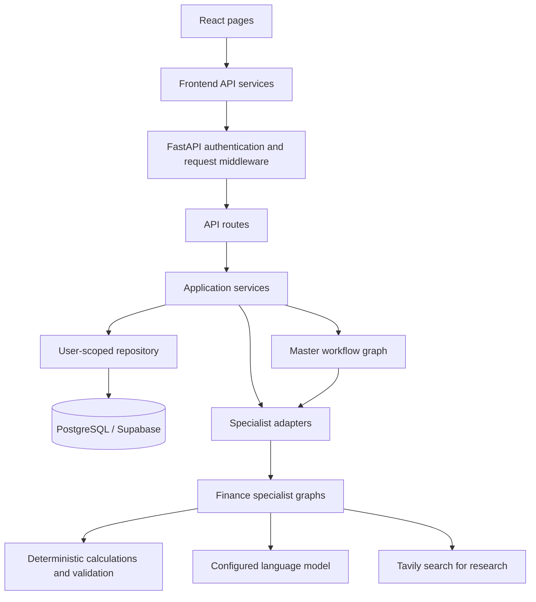
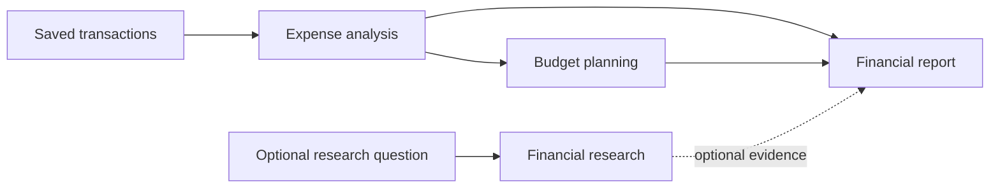

# FinAgent: project and workflow walkthrough

This guide describes the local implementation inspected on 20 October 2026. It explains the application source, configuration, examples, tests, and supporting files. Installed dependencies, compiled bundles, caches, Git internals, and operating-system metadata are explained as groups rather than as application logic. Private `.env` values are not reproduced. This is a code walkthrough, not a claim that the live deployment or external services were tested.

## 1. What this project does

FinAgent is a personal-finance web application. A user signs in, chooses a financial profile, and adds transactions. The application can calculate spending, produce a budget, research financial questions with sources, and compose a report. A Master Agent can arrange the specialist steps automatically.

There are three application layers:

| Layer | Location | Responsibility |
|---|---|---|
| Browser interface | `frontend/` | Forms, navigation, charts, history, uploads and downloads |
| Web application backend | `backend/app/` | Authentication, HTTP endpoints, stored data, orchestration and integration |
| Reusable finance package | `src/finagent/` | Shared data models, exact calculations and four specialist agents |

The finance package can run from Python without React or FastAPI. The backend exposes it to the browser. This separation explains why you see both a specialist `graph.py` and a backend adapter for the same specialist: the graph performs the work; the adapter makes that work usable through the web application.



An arrow means one part calls or uses another. The browser never directly calls the database, model provider, or Tavily.

## 2. Startup: what runs first

### Backend startup

The command `python -m uvicorn backend.app.main:app` imports `backend/app/main.py` and serves its `app` object.

1. `get_settings()` loads backend configuration. Root `.env`, backend `.env`, and process environment are supported.
2. `FastAPI(...)` constructs the application.
3. CORS rules, API routes, account routes, exception handlers and request middleware are registered.
4. `app.state.workflow_tasks` holds handles to currently running background workflows.
5. If `frontend/dist/index.html` exists, FastAPI also registers static assets and a React-page fallback.

Database engines are created lazily when storage is requested. Startup does not create tables or run migrations. `/api/v1/health` only establishes that the API responds; it does not prove database or provider availability.

### Browser startup

```text
frontend/index.html
  → frontend/src/main.jsx
  → BrowserRouter
  → AuthProvider
  → App.jsx
  → RequireAuth for private routes
  → AppLayout
  → selected page
```

`index.html` supplies `<div id="root">`. `main.jsx` mounts React there. `BrowserRouter` reads the URL. `AuthProvider` calls `/auth/me` to restore a session. `App.jsx` chooses the route. `RequireAuth` waits for authentication and redirects signed-out users to login. `AppLayout` renders the sidebar/header and places the selected page in its `Outlet`.

Most private pages are lazy-loaded: their JavaScript is loaded when that route is needed.

### Local development versus production

In development, Vite serves React on port 5173 and proxies `/api` to FastAPI on port 8000 by default. The browser can use relative API paths while Vite forwards them.

For production, Docker builds React first, then copies the output into the Python image. FastAPI serves both the browser app and API from one origin. React route URLs return `index.html`; React then chooses the page. Unknown `api/` paths remain API 404s.

## 3. Accounts and financial profiles

An **account** identifies a person signing in. A **financial profile** is a container for transactions, budgets and reports. One account can have multiple profiles, such as personal spending and a separate demo dataset.

Signup flows through:

```text
Auth.jsx → AuthContext.signIn("signup") → services/api.js
  → POST /api/v1/auth/signup → auth/routes.py
  → users table → personal profile → auth_sessions table
  → HttpOnly cookie → authenticated browser state
```

Passwords are salted and hashed with PBKDF2-SHA256 using 600,000 iterations. A random session token is sent as the `finagent_session` cookie; only its SHA-256 hash is stored in the session table. Sessions expire after seven days. Logout removes the session and clears the cookie. Login/signup have an in-process rate limiter.

The frontend uses `credentials: "include"` so the browser sends the cookie. JavaScript does not read its HttpOnly value.

For protected requests, middleware authenticates the cookie and attaches `request.state.user`. `configured_repository()` then chooses a repository scoped with `for_user(user_id)`. ORM criteria restrict profiles and financial records to that user, and newly created profile/research/workflow records receive that owner.

Browser local storage remembers the selected profile ID, currency, sample-profile marker and user ID. Persisted financial history lives in the database. Draft transactions and current conversation messages can exist temporarily in React memory.

## 4. How an ordinary API call works

For example, creating a budget:

1. The user presses the button in `BudgetPlanning.jsx`.
2. The page calls `createBudget()` from `services/agents.js`.
3. That calls shared `request()` in `services/api.js`.
4. `request()` serializes JSON and sends an authenticated HTTP request.
5. Backend middleware checks the session and request origin and establishes a request ID.
6. `api/routes.py` selects the budget endpoint.
7. `services/api.py` fetches the current saved analysis and validates freshness.
8. `BudgetPlanningAdapter` validates the request and resolves model configuration.
9. The synchronous finance graph runs in a threadpool.
10. Its result is wrapped with status, limitations, timing, versions and input hash.
11. The service saves the result through the repository.
12. The API returns a uniform HTTP envelope.
13. The frontend `request()` unwraps `data`; the page updates state and React renders it.

There are two different envelopes:

```json
{
  "request_id": "request-identifier",
  "status": "ok",
  "data": {
    "agent": "budget_planning",
    "status": "success",
    "result": {},
    "errors": [],
    "limitations": [],
    "provenance": {}
  },
  "warnings": [],
  "error": null
}
```

The outer status describes HTTP/API handling. The inner status describes specialist completion. A partial specialist result may still be delivered successfully over HTTP. The frontend API helper removes the outer wrapper before the page receives the value.

## 5. The complete transaction-to-report workflow

### Step A: choose a profile

`Profile.jsx` and `Dashboard.jsx` can create/select profiles. `POST /profiles` creates the container; `GET /profiles` lists the caller's profiles. Signup also supplies a personal profile.

### Step B: import or enter transactions

The main CSV path is:

```text
ExpenseAnalysis.jsx → CsvImport.jsx → read file as text
  → POST /profiles/{id}/imports/preview
  → csv_preview.py normalizes and checks rows
  → browser shows preview, errors and duplicate decisions
  → user starts analysis
  → POST /profiles/{id}/transactions
  → database commit
  → expense-analysis endpoint
```

Preview never saves the rows. It detects column aliases such as `Narration`, handles debit/credit columns, supports amount/date conventions, checks currency and flags duplicates. Ambiguous dates require a choice. Files are limited to 2 MB and 5,000 rows on this preview path. The user can change types/categories, exclude invalid rows and skip or keep duplicates.

When duplicates are deliberately kept, the browser gives them fresh IDs. The save endpoint validates the submitted batch and rejects the batch if it contains invalid rows or conflicting IDs. Saving happens before analysis; if analysis fails, the CSV component remembers that saving succeeded and can retry analysis without importing again.

Manual transactions and JSON imports are handled by `ExpenseAnalysis.jsx`. Draft rows are staged, converted to the shared transaction shape, then saved and analyzed. There is also an inline-profile analysis path for staged transactions when a profile has not already been selected.

Transactions store positive amounts. Their `type` determines how they affect totals:

| Type | Treatment |
|---|---|
| `income` | Money received |
| `expense` | Money spent |
| `refund` | Money received, also identified separately |
| `transfer` | Stored, excluded from income/spending |

Corrections update a saved row. Selection deletion is soft deletion: a JSON marker hides rows from active calculations, preserving an undo path and existing historical outputs.

### Step C: analyze spending

`POST /agents/expense-analysis/run` can receive `{ "profile_id": "..." }`. The service loads active transactions from storage and builds a `FinancialProfile`.

The expense graph runs:

```text
validate_input → compute_metrics → interpret → verify_interpretation → assemble
```

`calculations.py` owns financial arithmetic. It computes income, expenses, category averages, surplus, period totals and monthly breakdowns using `Decimal`.

The month denominator includes every calendar month from the earliest to the latest non-transfer transaction, including months with no entries. Category monthly averages are rounded first, then summed so the displayed categories exactly match monthly expenses.

Recurring detection uses explicit recurring flags or stable amounts across at least two months. Possible duplicates share date, normalized merchant and amount. Outliers use a modified z-score above 3.5 over at least five non-recurring expenses; a zero median absolute deviation does not produce that score. Data gaps cover missing categories, unclear descriptions, recurring status, missing income and insufficient history.

The LLM adds qualitative patterns and questions. It does not supply the authoritative arithmetic. The code checks category/transaction references and drops insights with unknown references. A model failure preserves calculated metrics and returns a partial result with a limitation.

### Step D: plan the budget

The budget page loads the latest saved analysis and budget. The backend rejects stale analyses even if a browser submits an older snapshot.

The budget graph runs:

```text
validate_request → baseline → propose → verify → assemble
```

The baseline defaults to a 20% income savings goal when none is supplied. It preserves essential categories at current spending and proportionally reduces flexible categories, normally no lower than 40% of their current spending. Unclassified spending is protected by default when missing-category gaps exist.

Feasibility asks whether the target fits after preserving essentials and flexible-category floors:

```text
maximum savings = max(0, income - essential costs - flexible floors)
shortfall = max(0, requested target - maximum savings)
```

The optional LLM may propose flexible limits within supplied bounds. Verification rejects missing/extra categories, duplicates, out-of-range limits, essential cuts, income violations and failure to meet the target. Rejected proposals fall back to the computed baseline.

An infeasible savings target can still produce a usable plan with an explicit shortfall. If protected costs themselves cannot fit within income, the planner returns failure.

Revisions retain the previous target/preferences unless changed, increment the revision number and record a parent budget plus category deltas. An unchanged analysis with no preference changes retains the previous plan.

### Step E: optionally research a question

Research can run without a financial profile, although the web API still requires a signed-in account. With a profile, the server builds fresh aggregate context from saved transactions and excludes stale budgets. Client-supplied `financial_context` is discarded on the web route.

The graph runs:

```text
plan_queries → search_official → search_general → rank_and_dedupe
  → synthesize → verify → assemble
```

Conditional branches can stop early on configuration/search failures. The query planner creates at most three queries. The graph searches official domains and then general results when the official phase has no failures. Sources are deduplicated by canonical URL and ordered primarily by provider relevance score, with official sources winning equal-score ties. Default official domains include RBI, SEBI and NISM.

The LLM writes findings from retrieved snippets plus financial context when available. Each accepted finding must cite known source IDs. The code also filters certain specific-security instructions. The conversation and requested language are passed as context for follow-ups.

Citation validation checks that IDs refer to retrieved sources; it does not mathematically prove every sentence is supported by the cited text. Query privacy is guided by the prompt; a raw-question fallback exists if query planning fails.

Missing search configuration produces an error. A failed synthesis can preserve real sources with a partial result. Sources are not synthesized to replace a missing provider.

### Step F: generate a report

The report page loads current analysis, budget, optional research and report history. The backend checks current stored inputs again.

```text
validate → compose → verify_composition → assemble
         ↘ assemble_rejection on invalid inputs
```

Validation checks versions, currencies, category coverage/current spending and arithmetic. A stale budget is rejected. Missing research, partial upstream results, gaps or infeasible savings produce warnings; a report can still be returned as flagged/partial.

The LLM contributes qualitative prose. Numeric tables and source structures are copied from upstream data. If generated prose contains numbers, the graph uses its deterministic template. Unknown narrative URLs/source IDs are removed.

Saved reports can be downloaded as JSON, Markdown or PDF. PDF generation uses ReportLab over stored report data and does not call the model again. The Markdown exporter includes selected narrative/research sections; it is not the complete JSON structure in another syntax.

## 6. What the Master Agent actually does

The Master Agent coordinates specialists. It has its own LangGraph workflow in `backend/app/orchestrator/graph.py`.

1. `MasterAgent.jsx` sends a task and optional profile/goal to `POST /workflows`.
2. The service reloads stored profile data, replaces browser-provided upstream financial snapshots, creates a running workflow record, and starts an `asyncio` background task.
3. The endpoint returns HTTP 202 with `run_id` immediately.
4. The browser polls workflow and trace endpoints every 1.5 seconds until a terminal status.
5. The planner asks the configured LLM for a structured plan or uses deterministic routing when a model is absent/unavailable.
6. Plan validation checks the agent allow-list, unique step IDs, required dependencies, valid input references, maximum steps and absence of dependency cycles.
7. Ready steps execute. Independent expense/research steps can run concurrently; dependent budget/report steps wait.
8. Results and upstream versions are validated. Retryable failures have bounded retries and exponential backoff. Stale dependent outputs can be invalidated and rerun, with a bounded replan count.
9. Synthesis extracts actual values into provenance claims and combines the results into an answer. A numeric/URL grounding check can reject generated narration and select deterministic text.
10. The bound workflow repository checks whether saved transactions changed during execution, saves acceptable specialist outputs into the same histories used by their pages, and finishes the existing run record.

The master graph is:

```text
plan → execute_step → validate → route
           ↑                     │
           └── more work ─────────┤
                                 └→ synthesize → END
```

For a financial report task, the usual dependency structure is:



Research is optional; a report can proceed with a warning when requested research fails. A failed mandatory financial dependency skips its dependent steps. Deterministic routing runs only recognized capabilities and does not interpret arbitrary conversation as a supported finance action. Invalid structured plans are rejected; planner invocation failures can use fallback routing.

A saved successful expense analysis may be reused when its version matches current transactions and the task does not explicitly request analysis. This avoids an unnecessary model call.

Default backend limits are eight plan steps, two retries per step after the initial attempt, two replans and 0.5 seconds initial backoff. These settings bound execution rather than providing unlimited autonomous loops.

Background tasks live inside the API process. Workflow/trace records are persisted, but execution is not backed by a durable worker queue. A restart can interrupt an in-flight task.

## 7. Why versions connect everything

`compute_version()` hashes a canonical representation and uses the first twelve SHA-256 hex characters with a prefix.

| Field | Describes |
|---|---|
| `analysis_version`, `ea-...` | Current financial profile and calculation version |
| `budget_id`, `bp-...` | Source analysis, target, preferences and revision |
| `source_analysis_version` | Analysis used to produce a budget |
| `report_version`, `fr-...` | Analysis, budget revision and research content |
| Report `source_versions` | Exact upstream analysis and budget references |

This is content-based freshness tracking, not an edit counter. Sorting transactions before hashing means merely reordering transactions does not invalidate the analysis.

After a transaction changes, old analyses/budgets/reports remain historical records. To create a current report, rerun analysis and revise the budget first. The backend compares versions and reports stale inputs instead of silently mixing generations.

## 8. File-by-file map

Paths below are relative to the repository root. Each row states a file's role and its connection to the workflow.

### Root files

| File | What happens here |
|---|---|
| `README.md` | Setup and integrated-app instructions. Its opening claim that agents are absent is outdated. |
| `pyproject.toml` | Defines the installable `finagent` package, Python dependencies and optional provider/backend/storage/test extras. Package discovery uses `src/`. Default pytest discovery targets `tests/`, so backend tests need explicit inclusion. |
| `.env.example` | Empty/example settings for the reusable agent package. |
| `.gitignore` | Rules for ignoring secrets, virtual environments, caches and builds. Already tracked files are not removed by ignore rules. |
| `.dockerignore` | Excludes secrets, dependencies and generated/local files from the Docker build context. |
| `Dockerfile` | Multi-stage React build and Python runtime; installs backend/persistence/Google extras, copies frontend build and runs Uvicorn as a non-root user. Other LLM providers require their optional packages. |
| `render.yaml` | Render service definition: Docker runtime, health route, provider settings and externally supplied secrets. Reading this file does not verify the current hosting state. |

### Reusable package and data contracts

| File | What happens here |
|---|---|
| `src/finagent/__init__.py` | Package description and version. |
| `src/finagent/config.py` | Agent-library environment settings and provider/search configuration checks, usable outside FastAPI. |
| `src/finagent/llm.py` | Creates LangChain model clients; handles Google alias and optional Google fallback on transient errors. Configures timeout/retries. It is not a separate trained model. |
| `src/finagent/sample_data.py` | Fictional transaction profile, feasible/infeasible goals, sample question and verification helpers for demos/tests. |
| `src/finagent/schemas/common.py` | `Money`, signed money, categories, transaction types, statuses, errors, limitations and deterministic versions. Decimal money is serialized as strings and float money inputs are rejected. |
| `src/finagent/schemas/financial.py` | Transactions, savings goals, profiles and summaries. Checks positive transaction amounts, unique IDs, currency and summary arithmetic. |
| `src/finagent/schemas/expense.py` | Expense request/result, recurring/outlier records, patterns and data gaps. |
| `src/finagent/schemas/budget.py` | Budget request, category limits, feasibility, revision metadata and plan. Checks limits plus savings stay within income. |
| `src/finagent/schemas/research.py` | Research request, bounded conversation, aggregate context, findings and source metadata. Checks cited source IDs exist. |
| `src/finagent/schemas/report.py` | Report request, validation issues, sections and upstream version references. |
| `src/finagent/schemas/__init__.py` | Re-exports shared models for convenient imports. |

### Expense agent

| File | What happens here |
|---|---|
| `src/finagent/agents/expense_analysis/calculations.py` | Pure Decimal calculations, recurrence, duplicates, outliers, gaps and analysis hash; also used by dashboard/freshness/research-context code. |
| `src/finagent/agents/expense_analysis/graph.py` | Validates, calculates, obtains qualitative interpretation, checks references and assembles `ExpenseAnalysisResult`. |
| `src/finagent/agents/expense_analysis/prompts.py` | Structured interpretation models and instructions limiting LLM output to patterns/questions. |
| `src/finagent/agents/expense_analysis/__init__.py` | Public exports for graph runners and calculation helpers. |
| `src/finagent/agents/expense_analysis/README.md` | Specialist interface, graph and failure documentation. |

### Budget agent

| File | What happens here |
|---|---|
| `src/finagent/agents/budget_planning/allocation.py` | Essential categories, flexible floors, exact proportional allocation, feasibility and invariant checks. Residual cents are allocated deterministically. |
| `src/finagent/agents/budget_planning/graph.py` | Validates source analysis, constructs baseline, optionally accepts a verified model proposal, creates versioned plans and revisions. |
| `src/finagent/agents/budget_planning/prompts.py` | Structured flexible-category proposal and bounded suggestion prompt. |
| `src/finagent/agents/budget_planning/__init__.py` | Exposes graph runner, revision and allocation helpers. |
| `src/finagent/agents/budget_planning/README.md` | Explains budgeting invariants, feasibility, graph and revision usage. |

### Research agent

| File | What happens here |
|---|---|
| `src/finagent/agents/financial_research/search.py` | Search-provider protocol, raw results, Tavily SDK wrapper, configuration and retryable search errors. |
| `src/finagent/agents/financial_research/source_ranking.py` | Official-domain classification, URL canonicalization/deduplication, relevance ordering and `S1`, `S2` source IDs. |
| `src/finagent/agents/financial_research/graph.py` | Query planning, real search, source ranking, synthesis and finding verification. |
| `src/finagent/agents/financial_research/prompts.py` | Query/synthesis schemas, conversation/language formatting and context/evidence instructions. |
| `src/finagent/agents/financial_research/__init__.py` | Public runner and search abstractions. |
| `src/finagent/agents/financial_research/README.md` | Search and research interface documentation; check source code for current ranking/search behavior. |

### Report agent

| File | What happens here |
|---|---|
| `src/finagent/agents/financial_report/validation.py` | Pure cross-input checks and stable valid/flagged/rejected decisions. |
| `src/finagent/agents/financial_report/graph.py` | Validates upstream inputs, composes qualitative text, filters prose and copies verified structures into a versioned report. |
| `src/finagent/agents/financial_report/prompts.py` | Qualitative composition schema and prompt. |
| `src/finagent/agents/financial_report/__init__.py` | Exposes report runner and validation utilities. |
| `src/finagent/agents/financial_report/README.md` | Report validation codes, status semantics and examples. |

### Backend entry, HTTP and configuration

| File | What happens here |
|---|---|
| `backend/app/main.py` | Creates FastAPI, installs middleware/routes/errors, holds workflow task handles and serves the production frontend. |
| `backend/app/auth/routes.py` | Signup/login/logout, password hashing, session-cookie handling, rate limiting and authentication. |
| `backend/app/api/routes.py` | Declares HTTP endpoints and request bodies; delegates agent/storage work; serves history and exports. |
| `backend/app/api/responses.py` | Wraps successes and converts validation, service and database failures into consistent API errors. |
| `backend/app/config/settings.py` | Backend configuration, CORS, database URI construction, provider configuration and workflow limits. |
| `backend/app/schemas/common.py` | HTTP response envelope, adapter availability, specialist envelope and provenance. Separate from finance-domain schemas. |
| `backend/.env.example` | Backend configuration template. |
| `backend/.env` | Local runtime configuration, ignored secret-bearing file; values are intentionally omitted from this guide. |
| `backend/PERSISTENCE.md` | Repository/storage/migration setup documentation. |

### Backend service and adapter layer

| File | What happens here |
|---|---|
| `backend/app/services/api.py` | Main application-service glue: repository/adapter selection, stored-profile reconstruction, freshness checks, batch imports, specialist saving and background workflow lifecycle. `_BoundWorkflowRepository` connects master output to ordinary histories. |
| `backend/app/services/research_context.py` | Builds fresh aggregate financial context, data notes and current-budget context from the caller's stored data. |
| `backend/app/services/report_pdf.py` | Builds a PDF from saved report sections using ReportLab, with budget table, checks, sources and provenance. |
| `backend/app/services/adapters/base.py` | Shared async adapter contract, model configuration, threadpool invocation, input hashing, timing and envelope conversion. |
| `backend/app/services/adapters/expense_analysis.py` | Validates expense input and calls the reusable expense graph. |
| `backend/app/services/adapters/budget_planning.py` | Validates budget input and dispatches create/revise calls, including revision preferences. |
| `backend/app/services/adapters/financial_research.py` | Resolves search/model integrations, invokes research and attaches server-derived financial context. |
| `backend/app/services/adapters/financial_report.py` | Validates report input and invokes report composition/validation. |
| `backend/app/services/adapters/__init__.py` | Exposes the four adapter implementations. |
| `backend/app/imports/csv_preview.py` | Converts varied bank-CSV formats into reviewable native transactions without saving them. |

### Master workflow

| File | What happens here |
|---|---|
| `backend/app/orchestrator/planning.py` | Structured proposed plan, deterministic task routing, dependency/reference/DAG validation and planner prompt. |
| `backend/app/orchestrator/schemas.py` | Plan steps, workflow state/results, trace events and provenance claims. |
| `backend/app/orchestrator/graph.py` | Plans, executes ready steps, retries, checks versions, invalidates dependencies and synthesizes the master result. |
| `backend/app/orchestrator/__init__.py` | Public workflow runner/state exports. |

### Database

| File | What happens here |
|---|---|
| `backend/app/db/models.py` | SQLAlchemy tables for users, sessions, profiles, transactions, analyses, budgets, research, reports, workflows and traces. Stores searchable columns plus complete JSON results. |
| `backend/app/db/session.py` | Lazy engine/session factory and connection-pool options; isolated in-memory SQLite support for tests. |
| `backend/app/db/migrate.py` | Explicit PostgreSQL migration command; tracks applied filenames and executes pending migrations transactionally under an advisory lock. |
| `backend/app/db/__init__.py` | Exposes the SQLAlchemy base metadata. |
| `backend/app/repositories/base.py` | Storage protocol and typed missing-configuration error. |
| `backend/app/repositories/postgres.py` | SQLAlchemy persistence implementation, user scoping, transaction upserts/soft deletion, histories, budget lineage and workflow/trace storage. Identical saved budget IDs reuse records. |
| `backend/app/repositories/__init__.py` | Exposes repository interface/factory/implementation. |
| `backend/migrations/001_initial_persistence.sql` | Creates financial tables, references and indexes. |
| `backend/migrations/002_accounts_and_ownership.sql` | Adds accounts/sessions and ownership columns, enables row-level security; does not assign legacy unowned data to a new account. |

Package marker files `backend/app/__init__.py`, `backend/app/api/__init__.py`, `backend/app/auth/__init__.py`, `backend/app/imports/__init__.py` and `backend/app/services/__init__.py` identify/describe packages and do not run finance workflows. `backend/app/config/__init__.py` exports settings; `backend/app/schemas/__init__.py` exports envelope models.

### Frontend startup and configuration

| File | What happens here |
|---|---|
| `frontend/index.html` | Browser document, metadata, root mount and module entry. |
| `frontend/src/main.jsx` | Mounts React, router, authentication provider and styles. |
| `frontend/src/App.jsx` | Public/private routes and lazy-loaded pages. |
| `frontend/src/auth/AuthContext.jsx` | Session restoration, sign-in/out, remembered workspace selection, expiry handling and route protection. |
| `frontend/src/layouts/AppLayout.jsx` | Shared sidebar, responsive navigation, header/account menu and page outlet. |
| `frontend/src/styles.css` | Global styling, layout, navigation, cards, states, public/auth pages and responsive rules. |
| `frontend/package.json` | React/router/chart/icon dependencies and dev/build/test scripts. |
| `frontend/package-lock.json` | Exact dependency tree used by `npm ci`; not app behavior. |
| `frontend/vite.config.js` | React/Tailwind plugins, API development proxy and Vitest browser-test configuration. |
| `frontend/tailwind.config.js` | Theme colors, typography, shadows and content paths. |
| `frontend/postcss.config.js` | Autoprefixer processing. |
| `frontend/.env.example` | Relative API URL and proxy configuration guidance; provider credentials stay backend-side. |
| `frontend/src/test-setup.js` | Supplies a ResizeObserver stub for chart rendering in browser-like tests. |

### Frontend pages

| File | What happens here |
|---|---|
| `frontend/src/pages/Landing.jsx` | Public explanation, illustrative graphics and account/workspace links. Illustration figures are not saved user results. |
| `frontend/src/pages/Auth.jsx` | Login/signup form, account-availability check, sign-in call and navigation after authentication. |
| `frontend/src/pages/Profile.jsx` | Account display and profile creation/selection; remembers selected currency/profile. |
| `frontend/src/pages/Dashboard.jsx` | Loads profile list, deterministic financial summary, latest budget, recent workflows and adapter availability; displays metrics/charts and explicit sample-data action. Summary reads do not run an LLM or save a fresh analysis. |
| `frontend/src/pages/ExpenseAnalysis.jsx` | Manual/JSON transaction staging, CSV component, saved transaction correction/deletion/undo, analysis execution and spending charts/insights/gaps. |
| `frontend/src/pages/BudgetPlanning.jsx` | Loads latest analysis/budget, collects target/essential preferences, creates/revises budgets, shows feasibility/charts/history and stale-state warnings. |
| `frontend/src/pages/FinancialResearch.jsx` | Research chat, follow-up context, language/region settings, saved questions, findings/citations and financial-context display. |
| `frontend/src/pages/Reports.jsx` | Loads source inputs/history, requests validated reports, displays sections/issues/source versions and downloads exports. |
| `frontend/src/pages/MasterAgent.jsx` | Submits natural-language workflows, polls status/trace, shows steps, results, claims, source links and prior runs. |

### Frontend API services

| File | What happens here |
|---|---|
| `frontend/src/services/api.js` | Shared fetch helper, JSON/blob handling, cookie credentials, response validation, ApiError and query-string helper. Dispatches session-expired events on protected 401s. |
| `frontend/src/services/agents.js` | Endpoint wrappers for adapter registry, analysis, budget/revision, research and reports. |
| `frontend/src/services/profiles.js` | Profile, sample data, transaction import/preview/correction/selection and analysis-history requests. |
| `frontend/src/services/budgets.js` | Budget list/detail/revision-history requests. |
| `frontend/src/services/research.js` | Research list/detail requests. |
| `frontend/src/services/reports.js` | Report list/detail/export requests, including PDF blobs. |
| `frontend/src/services/workflows.js` | Workflow creation, list, status and trace requests. |

### Shared frontend components

| File | What happens here |
|---|---|
| `frontend/src/components/CsvImport.jsx` | File selection, debounced server preview, mapping/options, row review, duplicate policy, save-then-analyze and analysis-only retry. |
| `frontend/src/components/ChartCard.jsx` | Shared heading/content wrapper around charts. |
| `frontend/src/components/MetricCard.jsx` | Value/label/detail card with optional trend icon. |
| `frontend/src/components/DataTable.jsx` | Table driven by column definitions, render functions and row keys. |
| `frontend/src/components/SourceList.jsx` | Renders retrieved source title, excerpt, URL, tier, dates and ID; optional filtering by citation IDs. |
| `frontend/src/components/StateViews.jsx` | Reusable loading, empty, warning and error states. |
| `frontend/src/components/StatusBadge.jsx` | Maps result/status strings to a readable styled badge. |

### Examples

| File | What happens here |
|---|---|
| `examples/run_expense_analysis.py` | Runs bundled profile analysis; `--no-llm` uses calculation helpers directly. |
| `examples/run_budget_planning.py` | Demonstrates feasible/infeasible targets and a revised budget after a profile change; supports `--no-llm`. |
| `examples/run_financial_research.py` | Checks real provider configuration and researches the sample question; does not substitute synthetic sources. |
| `examples/run_financial_report.py` | Demonstrates consistent inputs and stale-budget rejection; supports deterministic report composition. |

### Tests

Tests describe expected behavior; they are not called by the normal browser workflow. Most use injected fake models/search results or isolated databases.

| File | Behavior checked |
|---|---|
| `tests/test_schemas.py` | Money precision/float rejection, forbidden extra fields, totals, deterministic versions, serialization and references. |
| `tests/test_sample_data.py` | Validity, averages and feasibility of demo data. |
| `tests/test_llm_factory.py` | Google alias and transient fallback versus authorization failures. |
| `tests/agents/conftest.py` | Synthetic chat/search fixtures shared by agent tests. |
| `tests/agents/test_expense_calculations.py` | Exact totals, uncategorized costs, recurrence, outliers, duplicates, gaps and stable versions. |
| `tests/agents/test_expense_graph.py` | Successful interpretation, invalid input, model failures and invalid-reference filtering; includes a live smoke test. |
| `tests/agents/test_budget_allocation.py` | Feasibility, essential protection, floor rules, exact allocation, default target and unknown-category protection. |
| `tests/agents/test_budget_graph.py` | Proposal acceptance/rejection, input checks, revisions and changed goals. |
| `tests/agents/test_research_search.py` | Search configuration, timeout, wrapped provider errors, malformed responses and optional live search. |
| `tests/agents/test_research_source_ranking.py` | URL deduplication, official-domain boundaries, source dates and source-URL preservation. |
| `tests/agents/test_research_graph.py` | Citation-ID verification, search retries/failures, empty results, advice filters, context, language and relevance. |
| `tests/agents/test_report_validation.py` | Stale versions, currency/period mismatch and arithmetic consistency. |
| `tests/agents/test_report_graph.py` | Copied values, rejected/flagged inputs, version determinism, composition fallback and invented-source removal. |
| `backend/tests/test_main.py` | Health-response envelope and request ID. |
| `backend/tests/test_settings.py` | Optional defaults, environment lists and safe Supabase password encoding. |
| `backend/tests/test_adapters.py` | Adapter contracts, result status, configuration, provenance and revision dispatch. |
| `backend/tests/test_api.py` | HTTP endpoints, errors, import validation, histories/downloads, persisted master outputs, freshness and trusted research context. |
| `backend/tests/test_auth_workspace.py` | Account ownership boundaries, protected data, CSV/correction scope and transaction delete/restore. |
| `backend/tests/test_csv_preview.py` | CSV formats/mapping, ambiguous choices, bad rows, duplicates, transfers/refunds, empty calendar months and currency conflicts. |
| `backend/tests/test_persistence.py` | Lazy repository setup, exact amounts, output storage, budget lineage and duplicate-save reuse. |
| `backend/tests/test_orchestrator.py` | Routing/dependencies, real input passing, retries, stale revisions, skipped steps, plan validation, grounding and limits. |
| `frontend/src/services/api.test.js` | Envelope unwrapping and structured/malformed-response errors. |
| `frontend/src/components/CsvImport.test.jsx` | Preview without save, explicit import, no repeated import after analysis failure and explicit row decisions. |
| `frontend/src/pages/pages.test.jsx` | Dashboard and Master Agent loading, errors, real response rendering and sample labeling. |
| `frontend/src/pages/ExpenseBudget.test.jsx` | Expense/budget loading, save/analyze, goals, revision history and deletion undo. |
| `frontend/src/pages/ResearchReports.test.jsx` | Research context/citations/language conversation and report validation/rendering. |

To include both Python suites, specify `pytest tests backend/tests`; plain `pytest` uses the configured `tests/` path. Frontend tests use `npm --prefix frontend test`. Live tests can use external credentials; this walkthrough did not execute them.

### Documentation and sample input files

| File | Purpose |
|---|---|
| `docs/API.md` | API reference and stored-profile integration notes. Some statements are outdated, including PDF availability and summary persistence. |
| `docs/AUDIT.md` | Historical repository audit and integration proposal, useful background rather than current implementation truth. |
| `docs/PROGRESS.md` | Development chronology and previous verification notes. Historical results are not a fresh test run. |
| `docs/DEPLOYMENT.md` | Backend/Supabase configuration, migrations, local use and hosting instructions; includes historical environment notes. |
| `docs/PROJECT_WALKTHROUGH.md` | This source-based explanation. |
| `sample_imports/README.md` | Demo scenarios and recommended import workflow. |
| `sample_imports/01_balanced_month.csv` | Fictional balanced month. |
| `sample_imports/02_tight_budget.csv` | Fictional low-surplus month. |
| `sample_imports/03_two_months_history.csv` | Two-month demo for averages/history. |
| `sample_imports/04_irregular_income.csv` | Variable income across two months. |
| `sample_imports/05_high_spending.csv` | Spending above income. |
| `frontend/public/sample-expenses.csv` | Downloadable example copied into the production frontend build. |

### Generated, installed and internal files

| Path/group | Meaning |
|---|---|
| `frontend/node_modules/` | Third-party npm dependencies and their own source/tests/licenses. React, router, chart, Vite and test implementations live here; these are not project-authored feature files. Some dependency/build files are already tracked in this checkout despite ignore rules. |
| `.venv/` | Installed Python interpreter/packages for local execution. |
| `frontend/dist/` | Generated/minified frontend bundles, copied public assets and generated index. Rebuild from frontend source. |
| `src/finagent.egg-info/` | Generated package name/version/dependency/source metadata from installation. |
| `__pycache__/`, `*.pyc` | Python bytecode caches. |
| `.pytest_cache/`, Vite/Vitest cache directories | Test/build caches and previous-run metadata. |
| `.git/` | Version-control history, refs, hooks and index. Not part of runtime finance logic. |
| `.DS_Store` | macOS directory-view metadata. |
| Other local `.env` files, if present | Runtime configuration; private values are intentionally excluded. |

## 9. Worked example

Suppose a one-month profile has income of INR 80,000, essential costs of INR 40,000 and flexible expenses of INR 15,000.

Expense analysis calculates monthly spending of INR 55,000 and surplus of INR 25,000. These figures come from Python, not generated prose.

For a requested INR 30,000 savings target, flexible spending must drop to INR 10,000 while preserving essential costs. The 40% floor is INR 6,000 across those flexible categories. The target fits, and reductions are distributed proportionally by available category capacity.

For a requested INR 40,000 target, maximum savings under those rules is INR 34,000: 80,000 minus 40,000 minus 6,000. The result reports an INR 6,000 shortfall and does not claim the requested target was achieved.

When another expense is added, the analysis hash changes. The old budget points to the previous analysis, so report creation requires a refreshed analysis and budget. A Master Agent report task can coordinate those steps.

## 10. Practical reading order

To understand the code without jumping randomly, read:

1. `frontend/src/main.jsx`, `App.jsx`, `auth/AuthContext.jsx`.
2. One page, preferably `ExpenseAnalysis.jsx`, and its frontend service calls.
3. `backend/app/main.py`, `api/routes.py`, `services/api.py`.
4. Expense adapter, expense schema, calculation file and expense graph.
5. Budget schema, allocation and graph, then report validation/graph.
6. Repository and database models to understand persistence.
7. Master planning/state/graph and frontend polling.
8. Research search/ranking/graph for the external-evidence path.
9. Tests beside each feature to see expected successes, failures and edge cases.

The core division of work is: pages collect and show data; services transport and coordinate it; schemas define valid shapes; graphs arrange steps; calculation/validation functions enforce financial rules; repositories preserve records.
